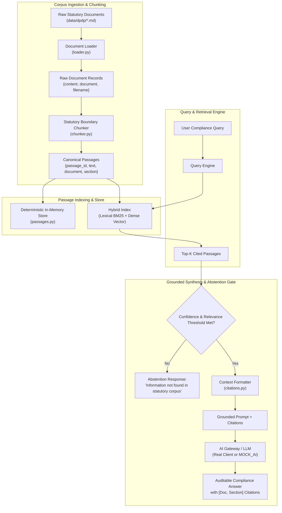

# System Architecture & Data Flow

---

## 1. High-Level Pipeline Architecture

The DPDP Research Assistant is architected with strict boundary separation between **Ingestion & Indexing**, **Retrieval**, and **Grounded Synthesis**.

---

## 2. Component Boundaries & Responsibilities

| Subsystem | Primary Module | Ingress Data | Egress Data | Failure Invariants |
| :--- | :--- | :--- | :--- | :--- |
| **Document Loader** | `src/dpdp/loader.py` | Markdown file paths on disk | Standardized `Document` dicts | Rejects empty files (`ValueError`), missing paths (`FileNotFoundError`), and directories (`IsADirectoryError`). |
| **Statutory Chunker** *(planned, not yet built)* | `src/dpdp/chunker.py` | `Document` dicts | List of canonical `Passage` dicts | Preserves legal section boundaries. Never cuts across clauses or paragraphs. |
| **Passage Store** | `src/dpdp/passages.py` | Canonical `Passage` dicts | In-memory key-value index indexed by `passage_id` | Computes deterministic slug IDs (`document:section[:clause-x]`) from passage fields. Rejects duplicate passage IDs at indexing time. |
| **Citation Formatter** | `src/dpdp/citations.py` | `Passage` dicts | Bracketed labels (`[Doc, Section]`) and context blocks | Rejects whitespace-only inputs. Strictly preserves statutory source references. Labels use document and section only; a passage's `clause` is not yet shown in the label. |
| **AI Gateway & Abstention** *(planned, not yet built)* | `src/dpdp/gateway/` | User query + Ranked passages | Verified response or abstention signal | Intercepts low retrieval scores and short-circuits to avoid LLM hallucinations. |

---

## 3. Invariants & Guarantees

1. **Deterministic Identity:** Every statutory passage receives a reproducible ID computed from its document name and section label (e.g. `dpdp-act-2023:section-4`), plus a `:clause-<x>` suffix when the passage carries a `clause` (e.g. `dpdp-act-2023:section-8:clause-5`). No random UUIDs. Implemented in `passages.py`.
2. **Statutory Integrity (target for the chunker, not yet built):** Legal sections remain unbroken units of truth. If a statutory section exceeds a single embedding chunk window, it is split into clause-level passages that keep the parent section metadata and carry a `clause` value.
3. **Zero-Key Execution:** The core pipeline, in-memory index, citation verification, and mock synthesis run without any external cloud API keys or billable credentials.
